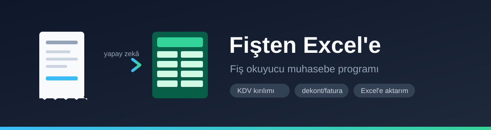
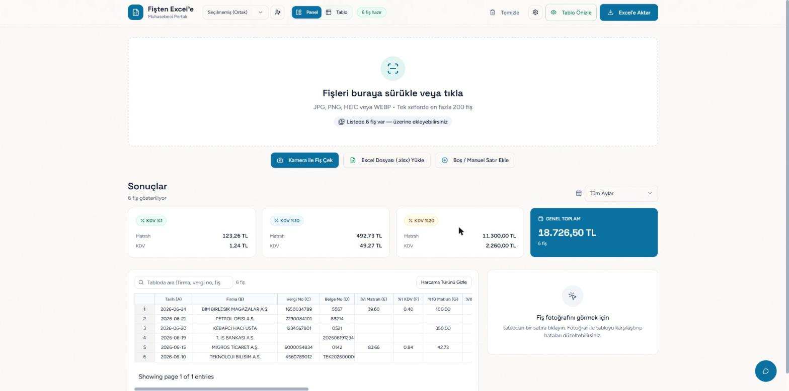
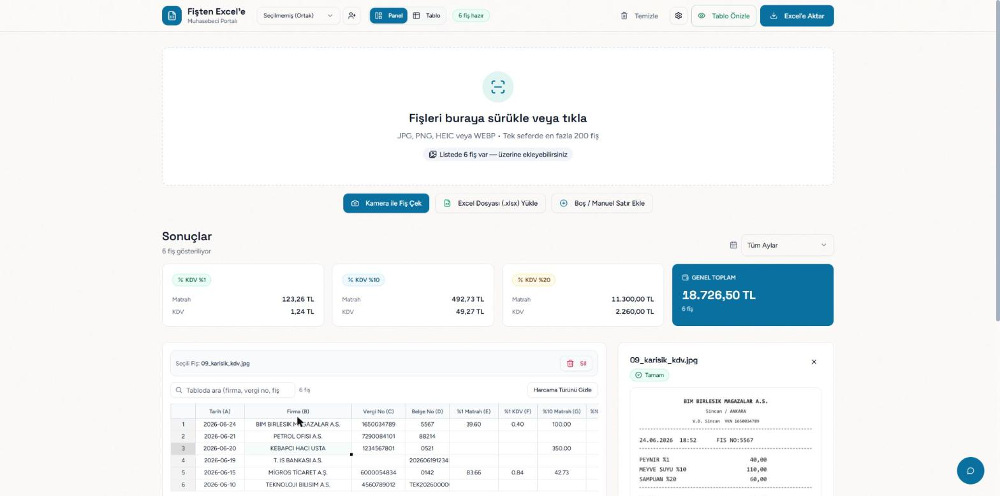

<p align="center">
  
</p>

<h1 align="center">Fişten Excel'e</h1>

<p align="center">
  <strong>Fiş okuyucu muhasebe programı</strong><br>
  Fiş, fatura ve dekont fotoğraflarını yapay zekâ ile okur; KDV kırılımıyla birlikte düzenlenebilir bir tabloya ve tek tıkla Excel'e aktarır.
</p>

<p align="center">
  
  
  
  
</p>

---

## Neden?

Muhasebeciler her ay yüzlerce fişi tek tek Excel'e giriyor: firma, tarih, KDV oranları, matrah, toplam… Saatler alıyor ve hataya çok açık. Bu program o işi fotoğraftan otomatik yapıyor.

## Özellikler

- 📷 **Toplu fiş yükleme** — JPG, PNG, HEIC, WEBP. Telefondan **kamerayla canlı çekim** desteği.
- 🧠 **Yapay zekâ ile okuma** — firma, vergi no/dairesi, tarih, belge no, **KDV kırılımı (%1 / %10 / %20)**, toplam, ödeme türü.
- 🧾 **Belge türü ayrımı** — yazarkasa fişi, e-fatura, fatura, **dekont**, gider pusulası. Dekontta KDV aranmaz, ödeme "havale/EFT" işaretlenir.
- 🏷️ **Harcama kategorisi** — gıda, akaryakıt, kırtasiye, inşaat… (gider hesabına atarken işe yarar).
- ✅ **Doğrulama** — matrah + KDV = toplam kontrolü, tarih kontrolü, güven skoru. Tutmayan fişler "kontrol gerekli" olarak işaretlenir.
- 🔁 **Zor fişte eskalasyon** — ilk okuma şüpheliyse otomatik olarak daha güçlü bir modelle yeniden okunur.
- 🚫 **"Fiş değil" algısı** — alakasız görseller tabloyu kirletmez, ayrı listelenir.
- 📊 **Excel'den içe aktarma** — mevcut muhasebe dosyalarınızı da okur. Sütun düzeni tanınmazsa yapay zekâ sütunları kendi çözer; çok sekmeli dosyalarda **sekme seçici** çıkar.
- 📤 **Stilli Excel çıktısı** — 3 sayfa: *Fişler*, *Aylık Özet* (beyanname için KDV kırılımı), *Firma Özeti*.
- 💬 **Sohbet asistanı** — "Ağustos fişlerini özetle", "mükerrerleri göster", "Migros fişinin toplamını 248,15 yap" gibi komutlarla tabloyu düzenleyebilir.
- ↩️ **Geri alınabilir silme**, mükerrer fiş tespiti, müşteri (mükellef) bazlı kayıt.
- 📈 **Yönetici paneli** — kullanım, maliyet takibi ve aktivite günlüğü (`#admin`).

## Ekran görüntüleri

**Fişler okunduktan sonra:** KDV oranlarına göre otomatik kırılım, genel toplam ve düzenlenebilir tablo.



**Fiş paneli:** tablodan bir satıra tıklayınca fişin fotoğrafı açılır; okunanla karşılaştırıp düzeltebilirsiniz.



> Görsellerdeki tüm veriler **test amaçlı üretilmiş örnek fişlerdir**, gerçek müşteri verisi içermez.

## Proje yapısı

```
.
├── backend/              # Node.js + Express API (port 8002)
│   ├── src/
│   │   ├── routes/       # Tüm /api uç noktaları
│   │   ├── services/     # Fiş işleme hattı, yapay zekâ, Excel, doğrulama
│   │   └── store/        # Oturum, kalıcı kayıt, analitik
│   └── store/            # db.json + fiş görselleri (git'e girmez)
├── frontend/             # React 19 + Tailwind + shadcn/ui (port 5600)
│   └── src/components/   # Tablo, yükleme alanı, sohbet, admin paneli
├── docs/                 # Görseller
├── render.yaml           # Backend deploy (Render)
└── netlify.toml          # Frontend deploy (Netlify)
```

**Fiş işleme hattı:** görsel → HEIC/boyut dönüşümü → yapay zekâ ile alan çıkarma → öğrenilen düzeltmelerin uygulanması → doğrulama → durum (`tamam` / `kontrol_gerekli` / `fis_degil`).

## Kurulum

Gereksinim: **Node.js 18+** ve bir **Kimi (Moonshot AI) API anahtarı** — <https://platform.moonshot.ai>

```bash
git clone <repo-adresi>
cd <klasor>

# Ortam dosyaları
cp backend/.env.example backend/.env
cp frontend/.env.example frontend/.env
# backend/.env içine KIMI_API_KEY değerinizi yazın

# Bağımlılıklar
cd backend  && npm install
cd ../frontend && npm install

# Çalıştırma (iki ayrı terminal)
cd backend  && npm run dev     # http://localhost:8002
cd frontend && npm start       # http://localhost:5600
```

Windows'ta kolay yol: `baslat.bat` (başlat) · `kapat.bat` (durdur) · `kontrol.bat` (durum).

### Ortam değişkenleri

| Değişken | Yer | Açıklama |
|---|---|---|
| `KIMI_API_KEY` | backend | **Zorunlu.** Moonshot AI anahtarı |
| `AI_MODEL` | backend | Ana model (varsayılan `kimi-k2.6`) |
| `ESCALATION_MODELS` | backend | Zor fişler için (varsayılan `kimi-k3.1-pro`) |
| `ADMIN_PASSWORD` | backend | Yönetici paneli şifresi |
| `ALLOWED_ORIGINS` | backend | CORS izinli adresler |
| `REACT_APP_BACKEND_URL` | frontend | Backend adresi (sonuna `/api` eklemeyin) |
| `REACT_APP_APP_PASSWORD` | frontend | Uygulama giriş şifresi (derleme anında gömülür) |

## Kullanılan yapay zekâ modelleri

| Rol | Model | Not |
|---|---|---|
| Ana okuma | `kimi-k2.6` | En uygun maliyetli vision modeli (~$0,003 / fiş) |
| Zor fiş (eskalasyon) | `kimi-k3.1-pro` | İlk okuma "kontrol gerekli" dönerse devreye girer |

Güncel model listesini `GET https://api.moonshot.ai/v1/models` ile doğrulayabilirsiniz.
Altyapıda Google Gemini ve NVIDIA NIM desteği de vardır (varsayılan olarak kapalı).

## Yayına alma

İki parça ayrı ayrı yayınlanır — Netlify statik olduğu için backend'i barındıramaz.

- **Frontend → Netlify:** `netlify.toml` hazır. `REACT_APP_BACKEND_URL` değişkenini backend adresine ayarlayın.
- **Backend → Render:** `render.yaml` blueprint hazır (`rootDir: backend`, sağlık kontrolü `/api/health`). Anahtarları panelden gizli olarak girin.
- Backend'in `ALLOWED_ORIGINS` değişkenine frontend adresinizi ekleyin.

Ayrıntılı adımlar: [`DEPLOY.md`](DEPLOY.md)

> Render'ın ücretsiz planında kalıcı disk yoktur; kayıtlar yeniden dağıtımda sıfırlanır ve servis bir süre sonra uyur (ilk istek ~50 sn sürebilir — uygulama bunun için bir bekleme ekranı gösterir).

## Güvenlik notu

- API anahtarları **asla** depoya girmez (`.env` git tarafından yok sayılır).
- Uygulamanın giriş şifresi istemci tarafındadır: meraklı ziyaretçileri ve botları keser, profesyonel bir saldırganı değil. Gerçek koruma gerekiyorsa sunucu tarafı kimlik doğrulaması ekleyin.

## Lisans

**[PolyForm Noncommercial 1.0.0](LICENSE)**

- ✅ Kullanabilir, inceleyebilir, değiştirebilir, paylaşabilirsiniz
- ✅ Kişisel kullanım, eğitim ve araştırma serbesttir
- ❌ **Ticari kullanım ve satış yasaktır**

> Not: Ticari kullanımı kısıtladığı için bu lisans OSI tanımıyla "open source" sayılmaz; **kaynağı açık (source-available)** bir lisanstır. Ticari kullanım için iletişime geçin.

## Katkı

Hata bildirimi ve öneriler için issue açabilirsiniz. Arayüz metinleri ve kod yorumları Türkçedir; katkılarda bu dili koruyun.

---

<sub>Bu proje yapay zekâ destekli (Claude Code) ile geliştirilmiştir.</sub>
